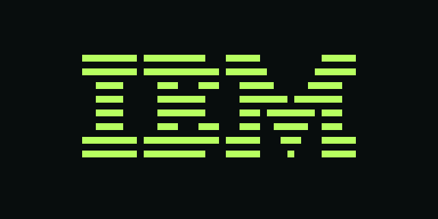

# Chip-8 Emulator (C, stdlib only)

A minimal Chip-8 interpreter written in plain C. No dependencies beyond a C compiler.

## Build

```sh
make
```

## Play a game

```sh
./play                 # pick a ROM from the bundled collection
./play path/to.ch8     # play a specific ROM
./chip8 path/to.ch8 --play [--speed N]
```

The emulator renders the 64x32 display in the terminal using half-block characters
(64x16 cells), so it fits in an 80-column terminal.

Key map:

```
1 2 3 4        -> Chip-8 keys 1 2 3 C
Q W E R        -> 4 5 6 D
A S D F        -> 7 8 9 E
Z X C V        -> A 0 B F
```

Controls:

| Key     | Action                        |
| ------- | ----------------------------- |
| `p`     | pause / resume                |
| `R`     | reset the ROM                 |
| `+`/`-` | increase / decrease speed     |
| `m`     | mute / unmute sound           |
| `ESC`   | quit                          |

Uppercase `Q` also quits. `--speed N` sets cycles per frame (default 10, ~600
instructions/sec at 60 fps); `+`/`-` adjust it live. Keys are held for a few
frames after a press, so taps and short holds both register.

The display defaults to half-block rendering. Use `--render full` for the old
double-width `██` rendering, or `--render half` to restore the compact one.

## Screenshots

The 64x32 display, captured from the emulator running real ROMs. The images
are SVG renderings of the exact framebuffer — no ROMs are included in this repo.


*IBM Logo — the classic first test.*


*Tetris (Fran Dachille, 1991) mid-game — a piece falling into the well.*


*Breakout (Carmelo Cortez, 1979) — bricks and paddle, waiting for serve.*

## ROMs

The `roms` directory is a symlink to a CHIP-8 program pack (75 games, demos and
programs). To download or update it:

```sh
./get-roms.sh
```

The collection comes from <https://github.com/kripod/chip8-roms>. Any `.ch8`
file can be played directly: `./chip8 my-game.ch8 --play`.

## Headless mode (testing)

```sh
./chip8 path/to/rom.ch8 [--cycles N] [--dump path|-] [--selftest]
```

- `--cycles N` — number of CPU cycles to run (default 2000).
- `--dump path` — write the 64x32 framebuffer to `path` (default stdout).
- `--selftest` — run an embedded ROM that draws a `0` digit.

```sh
./chip8 hello.ch8 --cycles 50
```

## Sound

The Chip-8 has a 1-bit buzzer that sounds while `sound_timer > 0`.

- `--sound bell` — ring the terminal bell once per 60 Hz tick (default in `--play`).
- `--sound wav --sound-file out.wav` — write a synthesized 440 Hz square wave to a WAV file.
- `--sound off` — silence.

`sound.ch8` sets the buzzer for 10 timer ticks and loops; it is a handy test ROM.

## Notes

- Display is 64x32; headless `--dump` writes `#` (on) / `.` (off).
- Timers tick at ~60 Hz.
- Keyboard input is tracked in `keys[16]`; `Fx0A` waits for a press. In headless
  mode this blocks, so most ROMs should be tested with a cycle cap.
- No graphics backend beyond the terminal front-end; SDL is a natural next step.
