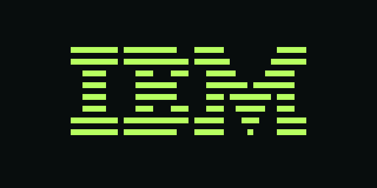

# CHIP-8 emulator

A compact CHIP-8 interpreter in C. It draws the 64×32 display in a terminal and plays the original one-bit buzzer as live audio.


*IBM Logo — the classic first test.*


*Tetris — a piece falling into the well.*


*Breakout — bricks and paddle, waiting for serve.*

These images show the emulator's framebuffer as PNGs.

## Build and play

You need a C99 compiler, `make`, and SDL2 development files for live audio. `pkg-config` is used to find SDL2.

```sh
make
./play path/to/game.ch8
# Or run a specific ROM directly:
./chip8 path/to/game.ch8 --play
```

The live sound is a smooth 440 Hz tone that follows the CHIP-8 sound timer. The `m` key mutes and unmutes it. Use `--sound off` for a silent play session. SDL2 is only needed for live audio; without it, the program still builds for headless use and WAV capture.

The terminal uses half-block characters by default to fit the display into 64×16 cells. Use `--render full` for double-width blocks. In play mode, use lowercase letters for the standard CHIP-8 key map; uppercase `R` resets the game:

```text
1 2 3 4        1 2 3 C
q w e r   →    4 5 6 D
a s d f        7 8 9 E
z x c v        A 0 B F
```

| Key | Action |
| --- | --- |
| `p` | Pause or resume |
| `R` | Reset the ROM |
| `+` / `-` | Increase or decrease speed |
| `m` | Mute or unmute sound |
| `Esc` | Quit |

The default speed is 10 cycles per frame. `--speed N` changes it when launching the emulator.

## ROMs

`hello.ch8` draws a small demo. `sound.ch8` sets the buzzer timer and loops, so it is a quick way to hear the sound output.

Pass any compatible `.ch8` file to `./play` or `./chip8`. To download the optional game collection and make it available in the picker, run:

```sh
./get-roms.sh
./play
```

The collection is cloned into `.roms-cache/`; `roms/` is a local symlink to its `games/` directory. Both paths are ignored by Git. The ROM collection comes from [kripod/chip8-roms](https://github.com/kripod/chip8-roms).

## Headless use

```sh
./chip8 hello.ch8 --cycles 50
./chip8 path/to/rom.ch8 --cycles 2000 --dump framebuffer.txt
./chip8 sound.ch8 --cycles 300 --sound wav --sound-file sound.wav
./chip8 --selftest
```

Headless mode runs 2,000 CPU cycles by default and prints the 64×32 framebuffer as `#` and `.`. `--dump PATH` writes it to a file; `--dump -` writes to standard output. `--sound wav` records a mono 48 kHz WAV, including silence, so the recording preserves the emulator's timing. The default output path is `chip8.wav`.

`make clean` removes the compiled executable. The ROMs and generated WAV files are not tracked by Git.
