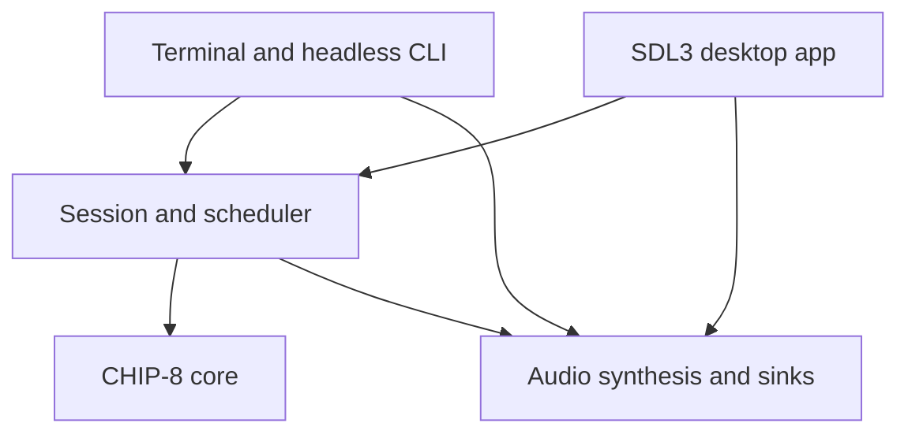

# Nacre desktop roadmap

Status: Milestone A's core and scheduler work is complete. Visual compatibility
review is deferred until Milestone B has an interactive window.
Initial architecture review: `f230915` (2026-11-13).
The current release is a terminal emulator; the desktop features below are planned.
The product is named Nacre and the executable is `nacre`. The repository remains
`tdotlab/nacre`; `chip8_*` identifiers describe the emulated architecture.

Implemented: a shared scheduler defaults to 600 instructions per second and ticks
CHIP-8 timers independently at 60 Hz. Headless WAV duration uses the same clock.
It caps each live catch-up interval at 250 ms, freezes timers while paused, and
advances timers during `Fx0A` key waits. Key waits require a fresh press and release.
`make test` covers timing across redraw intervals, pause, key wait/release during a
timer countdown, and one second of headless timing. CLI ROM and WAV smoke checks pass.
Focused core tests cover arithmetic/flag aliasing, calls/returns and stack overflow,
ROM/memory bounds, and sprite wrapping/collision. The README records current
instruction choices. The seven classic Timendus ROMs at revision
`742e9eac9f5d44466c1c9d83fcaa8158c6683cb1` all ran for 20,000 simulated cycles
without an emulator error. This is a crash smoke check, not a visual correctness
pass; keypad/quirks menus and the on-screen opcode/flags results need human review.

## The first result we want

A friend downloads a Mac app, moves it to Applications, opens it from Finder,
chooses a ROM, and plays with working controls and sound. She does not install a
compiler, Homebrew, SDL, Python, or Rust. The app works offline after installation.

The first preview should establish that complete path with a small feature set.
An elaborate library browser or debugger can follow once the app is pleasant to use.

## Recommended technology

Keep the emulator and desktop frontend in C. Use SDL3 for the window, rendering,
keyboard events, audio, and native file dialogs. Introduce CMake for separate core,
CLI, test, and desktop targets and macOS app packaging. Retain the terminal frontend.

SDL3's native file dialog API removes the need for a separate file-picker library.
Its audio API differs from SDL2, so migrate the existing audio backend as an explicit,
tested task rather than changing only includes and linker flags. Pin an exact stable
SDL3 release and archive checksum when implementation begins. Do not follow `main`.

| Approach | Benefit | Cost for this project | Recommendation |
| --- | --- | --- | --- |
| C core + C/SDL3 app | Shares the current code and one multimedia dependency; supports later Windows/Linux frontends | Small amount of platform glue for Mac menus and distribution | First choice |
| C core + SwiftUI/AppKit app | Strong native Mac controls and preferences | Another language and build integration; other platforms need their own shells | Revisit if a deeply native Mac interface becomes the priority |
| C core + Rust app | Useful for a substantially larger application; strong ownership tools in the shell | FFI, a second toolchain, bindings, and GUI dependency choices; existing C still needs validation | No clear payoff for the first version |
| C core + Python app | Quick interface experiments | Interpreter/toolkit bundling and native extension packaging | Useful for prototypes; less attractive for this small distributable app |

This is a project-size judgment, not a restriction on future languages. A narrow C
interface keeps a future Swift or Rust shell possible. SDL makes a desktop/game
window; native Mac menus and standard alerts may need a small Objective-C adapter.
Keep that adapter limited to platform integration.

## What the review found

These are source observations, not newly reproduced runtime failures.

| Area | Current behavior | Work needed |
| --- | --- | --- |
| Core boundary | `src/chip8.c` and `include/chip8.h` are separate from terminal input and SDL | Preserve this useful separation; keep the core independently buildable |
| Time | Shared scheduler; live CPU speed defaults to 600 instructions/second, timers independently tick at 60 Hz; headless uses the same timing | Finish core/profile checks and validate scheduling under a Mac event loop |
| CPU speed | `--speed N` sets N instructions per 60 Hz virtual frame | Preserve/document units and exercise speed changes during a live run |
| Input | The terminal simulates key holds for a few frames | Desktop uses real down/up events, supports simultaneous keys, and clears held keys on focus loss |
| Waiting for a key | `Fx0A` blocks for a fresh press and completes on release; timers continue while blocked | Confirm behavior against the selected compatibility profile and keypad tests |
| Compatibility | Vx shifts, unchanged I on register transfer, V0 jump offset, wrapping sprites, and other choices are documented as the current profile | Validate against external tests before claiming VIP, CHIP-48, or SUPER-CHIP accuracy |
| Unsupported extensions | The `0nnn` branch ignores system calls, including encodings used by some later extensions | Diagnose known unsupported extension instructions instead of apparently running incompatible games |
| Audio | Global state combines oscillator, WAV output, and SDL2 playback | Separate reusable synthesis from playback/file sinks; report write/close errors and define final partial recording behavior |
| Verification | Scheduler/key-wait/core checks, CLI ROM runs, WAV duration/format checks, and a 20,000-cycle smoke run of seven Timendus ROMs pass | Review visual test results in the desktop; crash-free execution alone does not prove opcode correctness |
| Mac readiness | POSIX terminal frontend and Makefile only; no bundle or release workflow | Desktop entry point, CMake, packaged dependencies, Mac build checks, and real Mac testing |
| Distribution | No project license or automated release checks are present in the reviewed tree | Owner chooses the license; verify demo/asset permissions and retain dependency notices before distribution |

Live SDL2 playback has not been compiled or heard in this workspace. The existing
runtime library is present but development files were unavailable through its package
manager. A successful WAV smoke check does not establish live playback correctness.

## Architecture to grow toward

The session owns the loaded ROM, initial seed, compatibility settings, pause state,
and scheduler. It supplies a clean reset and transactional ROM replacement: a failed
load should leave the current game intact. The core executes instructions and
exposes state without knowing about windows, files selected by users, or audio devices.
The scheduler accepts elapsed time; frontends obtain that time from their platform.

Use one main thread for emulation, input, and rendering initially. Keep audio work
limited to generating samples from safely published sound state. Do not read or
mutate the machine from an audio or file-dialog callback. SDL file dialogs are
asynchronous and their callbacks may run on another thread: copy the result into an
owned message, then load the ROM on the main thread.

| Proposed path | Responsibility |
| --- | --- |
| `src/core/`, `include/chip8.h` | Machine, opcodes, explicit compatibility settings |
| `src/runtime/` | Session lifecycle, ROM loading, scheduler, deterministic headless execution |
| `src/cli/` | Existing argument handling and terminal renderer |
| `src/desktop/` | SDL events, display, file opening, app commands |
| `src/audio/` | Oscillator, SDL3 playback, WAV capture |
| `platform/macos/` | Bundle metadata, icon, and any native menu adapter |
| `tests/` | Small C regression programs and compatibility test instructions |
| `cmake/`, `tools/` | Dependency configuration and packaging scripts |
| `assets/` | App resources and demo source with clear provenance |
| `docs/` | Current architecture, release instructions, and this roadmap |

Create directories as their code arrives. Avoid an empty framework of abstractions.
The existing root ROM paths and CLI remain usable during the migration.

## Milestone A: reliable execution underneath both frontends

The scheduler is implemented; a session wrapper remains optional until ROM replacement
or frontend lifecycle needs it. Use a monotonic clock for live runs and injected
elapsed time for checks. The default is 600 instructions/second with independent 60 Hz
timers, and CPU instructions run before a timer tick at the same instant. A single
live catch-up interval is capped at 250 ms. Pause freezes timer state and discards CPU
phase so resume cannot replay suspended time.

`Fx0A` now waits for a fresh press and its release; timer ticks continue while waiting.
Desktop will supply real down/up events; the terminal still approximates release.
Seed preservation and transactional ROM replacement remain future core work.

Focused core and scheduler checks now run without SDL, covering flag aliasing,
call/return limits, bounds, sprite wrap/collision, key wait, pause, and independent
60 Hz timers. Seven pinned Timendus ROMs execute 20,000 cycles without emulator
errors; this smoke run does not validate their on-screen results.

Review the visual output from the pinned Timendus opcode, flags, keypad, quirks, and
beep tests during interactive Mac testing. The headless smoke run does not check
their displayed results. Keep external test assets and their license notices
separate from the shipped app.

**Done when:** the CLI works, focused tests pass, current compatibility choices are
documented, and the pinned ROMs execute without emulator errors. Review their visual
results in Milestone B, which adds an interactive display.

## Milestone B: the first Finder-launchable window

Introduce CMake targets for the SDL-free core/tests, CLI, and SDL3 desktop app. Make
desktop dependencies optional for core-only builds. Keep `make` working as a thin
wrapper or retain its existing path until parity is established; update the README
when the actual build commands change.

Pin and build SDL3 within the release build. Prefer a static SDL3 library for the Mac
app so there is no separate SDL installation or external framework path to resolve.
Use normal system frameworks as required by SDL. If a bundled dynamic framework is
chosen instead, validate its bundle path and signing explicitly. Do not ship two SDL
major versions; migrate the CLI live-audio sink alongside the desktop backend.

Create an SDL3 window that renders the 64×32 framebuffer with nearest-neighbor
sampling, correct aspect ratio, Retina handling, and integer scaling where space
permits. Resize/letterbox cleanly. Reuse the same session and audio synthesis as the
CLI. Produce an initial macOS `.app` bundle with CMake's `MACOSX_BUNDLE` support.

**Done when:** a Mac build launches the bundle from Finder and runs a verified demo
with sound and real key down/up events. Review Timendus opcode, flags, keypad, and
quirks results in that interactive build. Linux checks and dummy SDL drivers can help
CI but do not replace this Mac acceptance check.

## Milestone C: a usable private preview

Add native Open ROM (`Cmd+O`), drag-and-drop, pause/resume, reset, mute/volume,
fullscreen, and an accessible way to see the key map. Provide an obvious opening
state and app-level commands rather than requiring knowledge of CLI flags. Use a
small Mac menu adapter if needed; avoid introducing a general GUI toolkit just for
a handful of commands. Use `Cmd+Q` to quit; Escape can leave fullscreen.

On focus loss, pause execution, release all emulated keys, and silence sound. Resume
only when appropriate, preserving a user's explicit pause. Treat file-dialog cancel
as a normal outcome. Show understandable errors for bad ROMs and unavailable audio;
allow silent play when no output device is available. Never crash because a recent
ROM was moved or removed.

Create a tiny original demo ROM with checked-in source/reproducible build steps, or
verify the provenance of the existing demos before bundling them. The optional
download script remains a developer convenience; the app must not clone a game
collection at launch. Do not assume a downloadable ROM collection grants permission
to redistribute every game.

**Done when:** the friend can open the preview, load a ROM, play, change focus,
pause/reset/mute, and quit without Terminal, package installation, or a crash.
This is the first release-sized slice; stop here for hands-on feedback.

## Milestone D: polish and repeatable Mac distribution

Confirm the friend's Mac architecture and macOS version before choosing the supported
minimum. Prefer an `arm64` + `x86_64` universal app if both can be built and validated;
otherwise label separate builds accurately. Set and test the deployment target rather
than inferring support from a successful build on a newer OS.

Use Nacre for the app name and choose a stable bundle identifier, version, icon, and
About information. Store preferences in the user's application-data location,
never inside the app bundle. Add recent ROMs and a small set of display palettes;
handle missing/corrupt settings without preventing startup. Replace provisional PNGs
with real app captures after the Mac UI exists.

Package a self-contained `.app` in a ZIP first; add a drag-to-Applications DMG when
it improves the handoff. For a normal downloadable release, use Developer ID signing,
the hardened runtime, Apple's notarization service, and a stapled ticket. Use current
`notarytool`/`stapler` tooling. Keep signing credentials in approved secret storage.
An unsigned/private preview is a distinct artifact and must be labeled accordingly.

Add CI for core tests/sanitizers on Linux and core/desktop builds on macOS. Produce
unsigned preview artifacts on demand; signed/tagged releases require the agreed
release authorization and signing setup. Inspect binary architectures and dynamic
dependencies and test the downloaded, quarantined artifact on a Mac without developer
dependencies. Check first launch, offline launch, sound, file dialogs, focus/sleep,
fullscreen, and relaunch from a path containing spaces.

**Done when:** the packaged app passes clean-Mac acceptance and its supported OS/CPU,
signing status, known issues, license, notices, and installation steps are documented.
Do not claim Intel or older-macOS runtime testing if it was only cross-compiled.

## After the first Mac release

| Order | Extension | Reason and boundary |
| --- | --- | --- |
| 1 | Explicit compatibility profiles and per-ROM settings | Improves real game support; expand only with profile-specific tests |
| 2 | Key remapping and gamepad support | Makes play comfortable; retain keyboard defaults and a reset-to-default action |
| 3 | Screenshots, recent ROMs, modest library view | Convenient, local features; no online catalog needed |
| 4 | Save states | Use a versioned format with ROM identity, profile, RNG, and machine state; never dump a raw C struct |
| 5 | Small debugger | Pause/step, registers, memory, disassembly, breakpoints; useful for learning and ROM authors |
| 6 | SUPER-CHIP | A separate project milestone: larger display modes, scrolling, extra instructions, and compatibility tests |
| 7 | Windows/Linux packaging | Reuses SDL frontend; audit the POSIX CLI separately before claiming Windows CLI support |
| Later | XO-CHIP, rewind, web build | Each changes scope materially; decide based on actual use after the base app works |

## Model-sized implementation handoff

Luna at max effort is the default builder requested by the owner. Give it one bounded
milestone or subtask per prompt, with acceptance checks. More effort does not replace
tests or a Mac acceptance run. The following are suggested choices, not prerequisites.

| Work | Codex recommendation | Claude alternative | Why |
| --- | --- | --- | --- |
| Scheduler, key semantics, compatibility design/review | Sol, high | Sonnet, high | Several timing and dialect interactions need careful review |
| Implement a specified core fix or SDL/CMake slice | Luna, max | Sonnet, medium | Small changes with concrete pass/fail checks suit the chosen workflow |
| Controls, preferences, palettes, screenshots | Luna, max | Haiku, high | Routine features once the shared architecture is settled |
| Mac packaging, dependency audit, release review | Sol, high | Sonnet, high | Distribution failures are often outside ordinary emulator logic |
| Future SUPER-CHIP/XO-CHIP design | Sol, xhigh | Opus, high | Broader state, rendering, and compatibility changes warrant a separate design pass |

Suggested next prompt for Luna:

> Read AGENTS.md and docs/ROADMAP.md. Implement the first vertical slice of Milestone
> B: add a minimal SDL3 window that loads the built-in demo, renders the CHIP-8 display,
> and maps real key down/up events into the existing core. Reuse the scheduler and
> audio timer behavior. Keep presentation plain and functional; leave visual styling
> for later. Add the CMake desktop target and preserve CLI/test targets. Test the core
> and every target available here. Record Mac verification that needs a Mac as pending.
> Update the roadmap with evidence and commit the finished slice under the existing
> repository authorization.

For each following prompt, name the next slice and copy its completion criteria.
Update this document in place as decisions settle. Add a separate architecture or
release guide when implemented behavior needs more detail; link it here rather than
copying it. Record a genuine test blocker and keep the corresponding acceptance
item open.

## Decisions to resolve before shipping

The product name is Nacre. Mac architecture/minimum OS, project license, and
availability of Developer ID signing remain open. These do not block core work or
the first desktop window; they do affect a distributable release. This plan does not
authorize purchases, account enrollment, or uploading a public release.

## Primary references

- [SDL3 native file dialog API](https://wiki.libsdl.org/SDL3/SDL_ShowOpenFileDialog)
- [SDL2 to SDL3 migration, including audio](https://wiki.libsdl.org/SDL3/README-migration)
- [SDL3 CMake integration and static/shared builds](https://wiki.libsdl.org/SDL3/README-cmake)
- [SDL3 macOS builds and universal architectures](https://wiki.libsdl.org/SDL3/README-macos)
- [CMake MACOSX_BUNDLE](https://cmake.org/cmake/help/latest/prop_tgt/MACOSX_BUNDLE.html)
- [Apple: notarizing macOS software](https://developer.apple.com/documentation/security/notarizing-macos-software-before-distribution)
- [Timendus CHIP-8 test suite](https://github.com/Timendus/chip8-test-suite)
