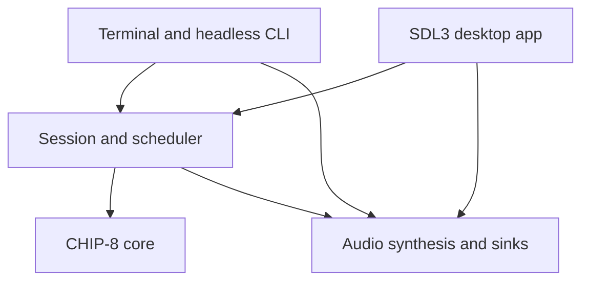

# Nacre desktop roadmap

Status: Milestone A is complete. A plain SDL3 desktop prototype now shares the C
core across macOS, Windows, and Linux builds. It includes the bundled demo, ROM
picker, keyboard input, pause/reset/mute, and timer-driven sound. CMake pins SDL3
3.4.20 and CI is configured to build each OS and upload artifacts. The desktop
target has not been compiled in this workspace because CMake and SDL3 are
unavailable here; CI and native Mac/Windows/Linux runtime checks remain pending.
Initial architecture review: `f230915` (2026-11-13).
The terminal frontend remains available while the desktop prototype is validated.
The product is named Nacre and the executable is `nacre`. The repository remains
`tdotlab/nacre`; `chip8_*` identifiers describe the emulated architecture.

Implemented: a shared scheduler defaults to 600 instructions per second and ticks
CHIP-8 timers independently at 60 Hz. Headless WAV duration uses the same clock.
It caps each live catch-up interval at 250 ms, freezes timers while paused, and
advances timers during `Fx0A` key waits. Key waits require a fresh press and release.
`make test` covers timing across redraw intervals, pause, key wait/release during a
timer countdown, and one second of headless timing. CLI ROM and WAV smoke checks pass.
Focused core tests cover arithmetic/flag aliasing, calls/returns and stack overflow,
ROM/memory bounds, and sprite wrapping/collision. The README records current
instruction choices. The seven classic Timendus ROMs at revision
`742e9eac9f5d44466c1c9d83fcaa8158c6683cb1` all ran for 20,000 simulated cycles
without an emulator error. This is a crash smoke check, not a visual correctness
pass; keypad/quirks menus and the on-screen opcode/flags results need human review.

## The first result we want

A friend downloads a Mac app, moves it to Applications, opens it from Finder,
chooses a ROM, and plays with working controls and sound. The shared SDL3 frontend
also builds for Windows and Linux; each OS gets its own executable and packaging.

The first hands-on acceptance remains the MacBook test because that is the machine
available to the first tester. Keep the app plain until that path works.

## Recommended technology

Keep the emulator and desktop frontend in C. Use SDL3 for the shared window,
rendering, keyboard events, audio, and native file dialogs. CMake builds the shared
core and desktop app; the existing Makefile continues to build the terminal CLI.
Keep packaging rules per OS, outside the CHIP-8 core.

SDL3's native file dialog API removes the need for a separate file-picker library.
The desktop uses SDL3 playback with the shared oscillator; the terminal's optional
live sink still uses SDL2. The CMake desktop build pins an exact SDL3 release and
archive checksum rather than following `main`.

| Approach | Benefit | Cost for this project | Recommendation |
| --- | --- | --- | --- |
| C core + C/SDL3 app | Shares core, input, rendering, and audio across Mac/Windows/Linux | OS-specific packaging and a small amount of menu integration | First choice; prototype in place |
| C core + SwiftUI/AppKit app | Strong native Mac controls and preferences | Another language and build integration; other platforms need their own shells | Revisit if a deeply native Mac interface becomes the priority |
| C core + Rust app | Useful for a substantially larger application; strong ownership tools in the shell | FFI, a second toolchain, bindings, and GUI dependency choices; existing C still needs validation | No clear payoff for the first version |
| C core + Python app | Quick interface experiments | Interpreter/toolkit bundling and native extension packaging | Useful for prototypes; less attractive for this small distributable app |

This is a project-size judgment, not a restriction on future languages. A narrow C
interface keeps a future Swift or Rust shell possible. SDL makes a desktop/game
window; native Mac menus and standard alerts may need a small Objective-C adapter.
Keep that adapter limited to platform integration.

## What the review found

These are source observations, not newly reproduced runtime failures.

| Area | Current behavior | Work needed |
| --- | --- | --- |
| Core boundary | `src/chip8.c` and `include/chip8.h` are separate from terminal input and SDL | Preserve this useful separation; keep the core independently buildable |
| Time | Shared scheduler; live CPU speed defaults to 600 instructions/second, timers independently tick at 60 Hz; headless uses the same timing | Finish core/profile checks and validate scheduling under a Mac event loop |
| CPU speed | `--speed N` sets N instructions per 60 Hz virtual frame | Preserve/document units and exercise speed changes during a live run |
| Input | The terminal simulates key holds for a few frames; desktop source maps real down/up events and clears keys on focus loss | Verify simultaneous keys and focus behavior on each native target |
| Waiting for a key | `Fx0A` blocks for a fresh press and completes on release; timers continue while blocked | Confirm behavior against the selected compatibility profile and keypad tests |
| Compatibility | Vx shifts, unchanged I on register transfer, V0 jump offset, wrapping sprites, and other choices are documented as the current profile | Validate against external tests before claiming VIP, CHIP-48, or SUPER-CHIP accuracy |
| Unsupported extensions | The `0nnn` branch ignores system calls, including encodings used by some later extensions | Diagnose known unsupported extension instructions instead of apparently running incompatible games |
| Audio | Shared oscillator feeds WAV/SDL2 CLI sinks and the SDL3 desktop callback | Verify both live sinks on devices; report write/close errors and define final partial recording behavior |
| Verification | Scheduler/key-wait/core checks, CLI ROM runs, WAV duration/format checks, and a 20,000-cycle smoke run of seven Timendus ROMs pass | Review visual test results in the desktop; crash-free execution alone does not prove opcode correctness |
| Mac readiness | SDL3/CMake prototype and app bundle target exist; no native build or Mac run yet | Build the bundle, verify its bundled ROM/audio, and test launch/input on a real Mac |
| Distribution | OS build matrix is configured to upload unsigned artifacts and include SDL's license; project license and demo-ROM provenance remain open | Run the matrix; choose a project license, verify demo/asset permissions, and retain notices before distribution |

The SDL2 terminal live sink has not been compiled or heard in this workspace. The
desktop SDL3 audio path also needs a real-device listening check. A successful WAV
smoke check does not establish live playback correctness.

## Architecture to grow toward

The session owns the loaded ROM, initial seed, compatibility settings, pause state,
and scheduler. It supplies a clean reset and transactional ROM replacement: a failed
load should leave the current game intact. The core executes instructions and
exposes state without knowing about windows, files selected by users, or audio devices.
The scheduler accepts elapsed time; frontends obtain that time from their platform.

Use one main thread for emulation, input, and rendering initially. The audio callback
reads only the atomic sound state and owns its oscillator. Do not read or mutate the
machine from an audio or file-dialog callback. SDL file dialogs are asynchronous and
their callbacks may run on another thread: copy the result into an owned event, then
load the ROM on the main thread.

| Path | Responsibility |
| --- | --- |
| `src/core/`, `include/chip8.h` | Machine, opcodes, explicit compatibility settings |
| `src/runtime/` | Session lifecycle, ROM loading, scheduler, deterministic headless execution |
| `src/cli/` | Existing argument handling and terminal renderer |
| `src/main.c`, `Makefile` | Existing terminal and headless CLI |
| `src/audio.c`, `include/audio.h` | Shared oscillator and CLI WAV/SDL2 sinks |
| `src/desktop/main.c` | Shared SDL3 window, input, ROM picker, and playback |
| `CMakeLists.txt`, `.github/workflows/desktop.yml` | Pinned SDL3 build and OS build artifacts |
| macOS bundle properties in CMake | Bundle metadata; add native adapters only if later needed |
| `tests/` | Small C regression programs and compatibility test instructions |
| `cmake/`, `tools/` | Dependency configuration and packaging scripts |
| `assets/` | App resources and demo source with clear provenance |
| `docs/` | Current architecture, release instructions, and this roadmap |

Keep the current compact layout until a real feature needs a split. The existing root
ROM paths and CLI remain usable alongside the desktop frontend.

## Milestone A: reliable execution underneath both frontends

The scheduler is implemented; a session wrapper remains optional until ROM replacement
or frontend lifecycle needs it. Use a monotonic clock for live runs and injected
elapsed time for checks. The default is 600 instructions/second with independent 60 Hz
timers, and CPU instructions run before a timer tick at the same instant. A single
live catch-up interval is capped at 250 ms. Pause freezes timer state and discards CPU
phase so resume cannot replay suspended time.

`Fx0A` now waits for a fresh press and its release; timer ticks continue while waiting.
The desktop maps real down/up events in source; native input validation is pending. The terminal still approximates release.
Seed preservation and transactional ROM replacement remain future core work.

Focused core and scheduler checks now run without SDL, covering flag aliasing,
call/return limits, bounds, sprite wrap/collision, key wait, pause, and independent
60 Hz timers. Seven pinned Timendus ROMs execute 20,000 cycles without emulator
errors; this smoke run does not validate their on-screen results.

Review the visual output from the pinned Timendus opcode, flags, keypad, quirks, and
beep tests during interactive Mac testing. The headless smoke run does not check
their displayed results. Keep external test assets and their license notices
separate from the shipped app.

**Done when:** the CLI works, focused checks pass, current compatibility choices are
documented, and the pinned ROMs execute without emulator errors. Their visual
results remain part of Milestone B's native acceptance.

## Milestone B: plain cross-platform desktop prototype

Implemented in `src/desktop/main.c`: one SDL3 frontend renders the 64×32 display,
preserves its 2:1 ratio with nearest-neighbor scaling, loads the bundled demo or a
selected ROM, maps real key down/up events, and provides pause, reset, mute, and
timer-driven sound. CMake creates a macOS `.app` and Windows/Linux
executables with the same source. SDL3 is linked statically; the existing Makefile
CLI remains separate.

The CI matrix is configured to build all three OS targets and upload artifacts. It
has not run yet for this prototype. This environment also lacks CMake and SDL3
headers, so no local desktop compile or native runtime claim is made.

**Acceptance still pending:** CI must compile the three builds; a Mac user must launch
the app, open a ROM, verify keypad down/up behavior and sound, and inspect the
Timendus opcode, flags, keypad, and quirks results. Windows and Linux need native
launch/input/audio checks before they are described as runtime-verified.

## Milestone C: friend-test preview

Add a Mac app menu and an accessible key-map surface; consider drag-and-drop and
fullscreen after the first test. The prototype uses `Cmd+O`, `Cmd+Q`, and Escape
keyboard shortcuts without a menu. Keep presentation plain until the ROM-to-game
path works for the friend.

The prototype pauses and releases keys on focus loss, treats dialog cancellation as
normal, keeps the previous game if a ROM load fails, and continues silently if audio
cannot open. Verify these behaviors on macOS and improve any rough edges the friend
finds. Never crash because a recent ROM was moved or removed.

Create a tiny original demo ROM with checked-in source/reproducible build steps, or
verify the provenance of the existing demos before bundling them. The optional
download script remains a developer convenience; the app must not clone a game
collection at launch. Do not assume a downloadable ROM collection grants permission
to redistribute every game.

**Done when:** the friend can open the preview, load a ROM, play, change focus,
pause/reset/mute, and quit without Terminal or a separately installed SDL runtime.
Use that feedback before adding visual polish or a larger library interface.

## Milestone D: polish and repeatable Mac distribution

Confirm the friend's Mac architecture and macOS version before choosing the supported
minimum. Prefer an `arm64` + `x86_64` universal app if both can be built and validated;
otherwise label separate builds accurately. Set and test the deployment target rather
than inferring support from a successful build on a newer OS.

Use Nacre for the app name and choose a stable bundle identifier, version, icon, and
About information. Store preferences in the user's application-data location,
never inside the app bundle. Add recent ROMs and a small set of display palettes;
handle missing/corrupt settings without preventing startup. Replace provisional PNGs
with real app captures after the Mac UI exists.

Package a self-contained `.app` in a ZIP first; add a drag-to-Applications DMG when
it improves the handoff. For a normal downloadable release, use Developer ID signing,
the hardened runtime, Apple's notarization service, and a stapled ticket. Use current
`notarytool`/`stapler` tooling. Keep signing credentials in approved secret storage.
An unsigned/private preview is a distinct artifact and must be labeled accordingly.

The desktop build matrix already uploads unsigned artifacts. Add core tests/sanitizers
and verify each downloaded app before calling it a preview. Signed/tagged releases
require the agreed release authorization and signing setup. Inspect architectures and dynamic
dependencies and test the downloaded, quarantined artifact on a Mac without developer
dependencies. Check first launch, offline launch, sound, file dialogs, focus/sleep,
fullscreen, and relaunch from a path containing spaces.

**Done when:** the packaged app passes clean-Mac acceptance and its supported OS/CPU,
signing status, known issues, license, notices, and installation steps are documented.
Do not claim Intel or older-macOS runtime testing if it was only cross-compiled.

## After the first Mac release

| Order | Extension | Reason and boundary |
| --- | --- | --- |
| 1 | Explicit compatibility profiles and per-ROM settings | Improves real game support; expand only with profile-specific tests |
| 2 | Key remapping and gamepad support | Makes play comfortable; retain keyboard defaults and a reset-to-default action |
| 3 | Screenshots, recent ROMs, modest library view | Convenient, local features; no online catalog needed |
| 4 | Save states | Use a versioned format with ROM identity, profile, RNG, and machine state; never dump a raw C struct |
| 5 | Small debugger | Pause/step, registers, memory, disassembly, breakpoints; useful for learning and ROM authors |
| 6 | SUPER-CHIP | A separate project milestone: larger display modes, scrolling, extra instructions, and compatibility tests |
| 7 | Windows release | Reuse the SDL frontend; verify native input/audio and choose a Windows install format |
| Later | Linux release | Reuse the SDL frontend; choose package formats and validate on the intended distributions |
| Later | XO-CHIP, rewind, web build | Each changes scope materially; decide based on actual use after the base app works |

## Model-sized implementation handoff

Luna at max effort is the default builder requested by the owner. Give it one bounded
milestone or subtask per prompt, with acceptance checks. More effort does not replace
tests or a Mac acceptance run. The following are suggested choices, not prerequisites.

| Work | Codex recommendation | Claude alternative | Why |
| --- | --- | --- | --- |
| Scheduler, key semantics, compatibility design/review | Sol, high | Sonnet, high | Several timing and dialect interactions need careful review |
| Implement a specified core fix or SDL/CMake slice | Luna, max | Sonnet, medium | Small changes with concrete pass/fail checks suit the chosen workflow |
| Controls, preferences, palettes, screenshots | Luna, max | Haiku, high | Routine features once the shared architecture is settled |
| Mac packaging, dependency audit, release review | Sol, high | Sonnet, high | Distribution failures are often outside ordinary emulator logic |
| Future SUPER-CHIP/XO-CHIP design | Sol, xhigh | Opus, high | Broader state, rendering, and compatibility changes warrant a separate design pass |

Suggested next prompt for Luna:

> Read AGENTS.md and docs/ROADMAP.md. Build the CMake desktop target for macOS,
> Windows, and Linux. Fix compile or packaging failures without adding visual polish.
> Run the Mac artifact on the friend's Mac and verify ROM opening, keyboard input,
> pause/reset/mute, focus loss, and sound. Record OS/version and exact results. Keep
> Windows/Linux runtime claims open until tested on those systems. Update the README
> and roadmap with evidence.

For each following prompt, name the next slice and copy its completion criteria.
Update this document in place as decisions settle. Add a separate architecture or
release guide when implemented behavior needs more detail; link it here rather than
copying it. Record a genuine test blocker and keep the corresponding acceptance
item open.

## Decisions to resolve before shipping

The product name is Nacre. Mac architecture/minimum OS, project license, and
availability of Developer ID signing remain open. These do not block core work or
the first desktop window; they do affect a distributable release. This plan does not
authorize purchases, account enrollment, or uploading a public release.

## Primary references

- [SDL3 native file dialog API](https://wiki.libsdl.org/SDL3/SDL_ShowOpenFileDialog)
- [SDL2 to SDL3 migration, including audio](https://wiki.libsdl.org/SDL3/README-migration)
- [SDL3 CMake integration and static/shared builds](https://wiki.libsdl.org/SDL3/README-cmake)
- [SDL3 macOS builds and universal architectures](https://wiki.libsdl.org/SDL3/README-macos)
- [CMake MACOSX_BUNDLE](https://cmake.org/cmake/help/latest/prop_tgt/MACOSX_BUNDLE.html)
- [Apple: notarizing macOS software](https://developer.apple.com/documentation/security/notarizing-macos-software-before-distribution)
- [Timendus CHIP-8 test suite](https://github.com/Timendus/chip8-test-suite)
